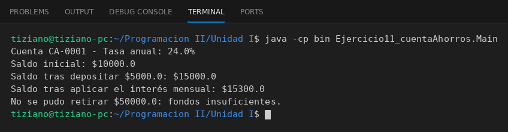

# CuentaAhorros

Programación II - Unidad 1 - Ejercicio 11

## Consigna
Modelar una cuenta de ahorros que calcule y aplique intereses mensuales sobre el saldo, y permita depositar y retirar fondos.

## Lógica
- **Atributos (privados):** `numeroCuenta` (String), `saldo` y `tasaInteresAnual` (double).
- **Constructor:** valida que saldo y tasa no sean negativos (`IllegalArgumentException` si no).
- **`aplicarInteresMensual()`:** suma al saldo `saldo * (tasaInteresAnual / 12) / 100`, es decir, la doceava parte de la tasa anual expresada en porcentaje.
- **`depositar(monto)`:** suma el monto al saldo; rechaza montos no positivos.
- **`retirar(monto)`:** si hay saldo suficiente lo descuenta y retorna `true`; si no, no modifica el saldo y retorna `false`.
- **`Main`:** cuenta de $10000 con tasa anual 24%, deposita $5000, aplica el interés mensual (2% = $300, saldo $15300) e intenta un retiro mayor al saldo.

## Ejecución

